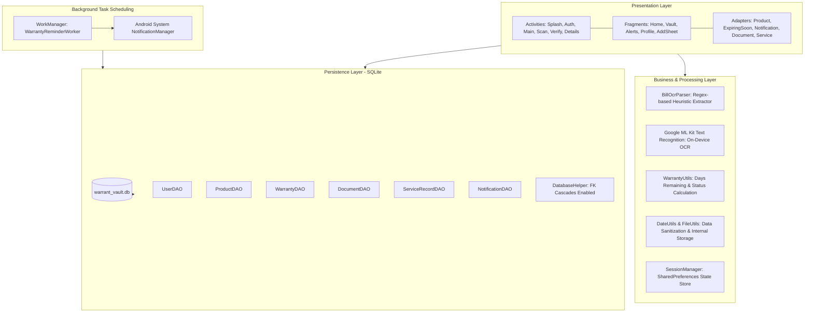
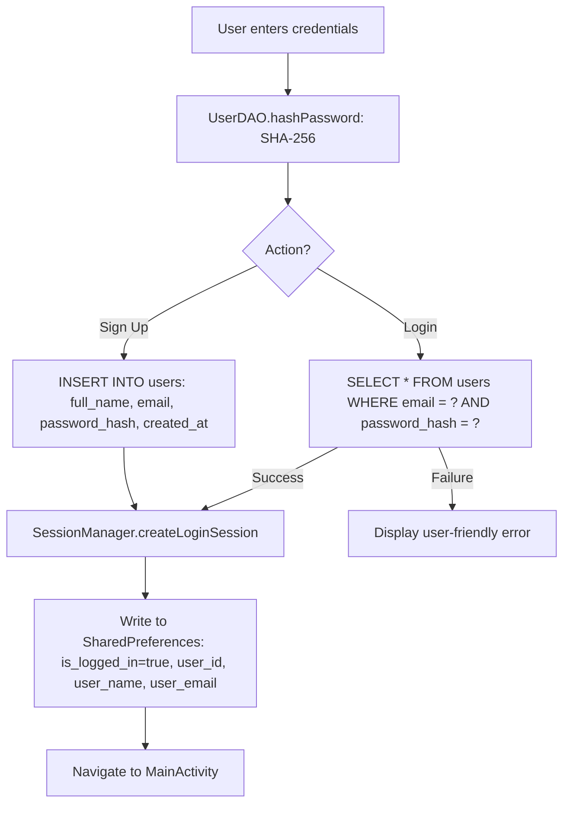
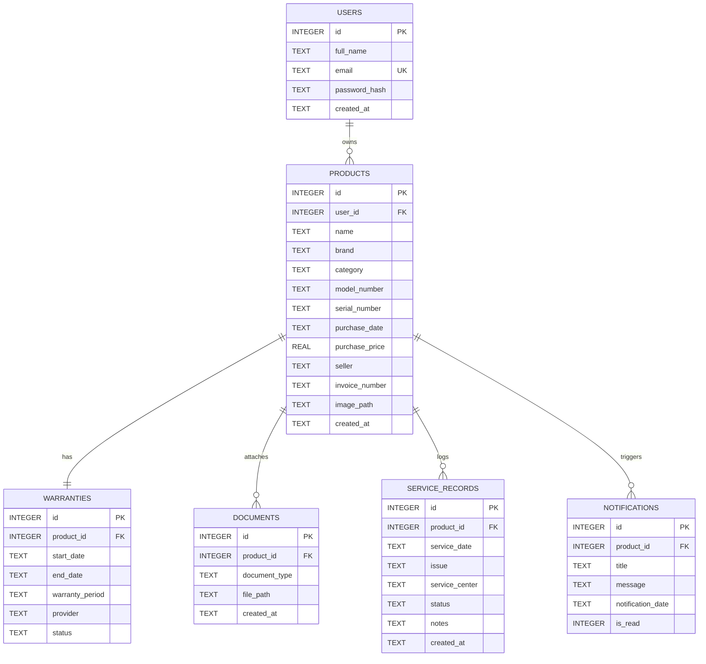
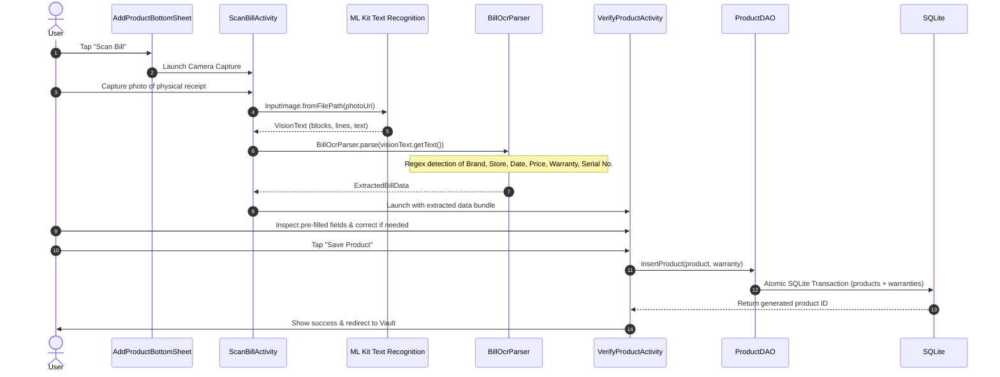
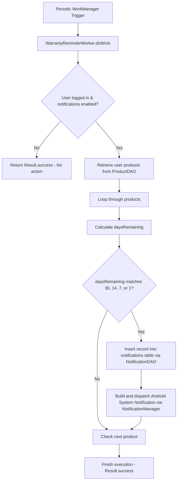
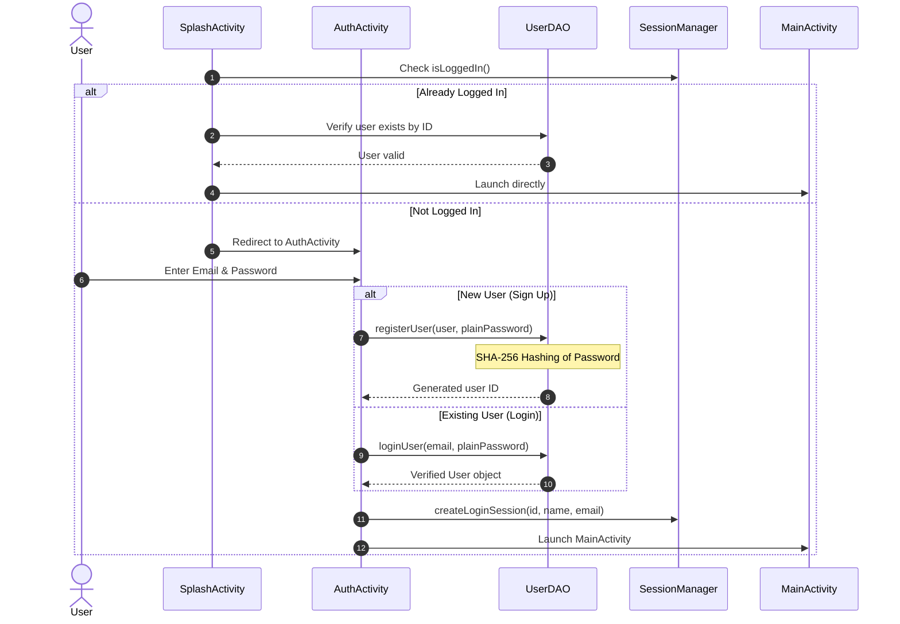

# Warrant Vault — Complete System Guide & Architecture Reference

<p align="center">
  
</p>

<p align="center">
  <strong>Digital Warranty &amp; Bill Manager for Android</strong><br>
  <em>Native Java • Offline-First • SQLite • Google ML Kit Text Recognition • Jetpack WorkManager</em>
</p>

---

## Table of Contents
1. [Executive Summary & High-Level Architecture](#1-executive-summary--high-level-architecture)
2. [Full Project File Structure](#2-full-project-file-structure)
3. [Authentication & Session Storage Architecture](#3-authentication--session-storage-architecture)
4. [Product & Warranty Data Storage Architecture](#4-product--warranty-data-storage-architecture)
5. [Database Entity-Relationship (ER) Model](#5-database-entity-relationship-er-model)
6. [Component Guide: Packages & Responsibilities](#6-component-guide-packages--responsibilities)
   - [Domain Models](#61-domain-models-models)
   - [Database & DAOs](#62-database--daos-database--dao)
   - [Activities](#63-activities-activities)
   - [Fragments & Dialogs](#64-fragments-fragments)
   - [Adapters](#65-adapters-adapters)
   - [Utilities & Background Workers](#66-utilities--background-workers-utils--workers)
7. [End-to-End Workflows](#7-end-to-end-workflows)
   - [Workflow A: Bill Scanning, OCR & Product Verification](#workflow-a-bill-scanning-ocr--product-verification)
   - [Workflow B: Background Expiry Checks & Push Alerts](#workflow-b-background-expiry-checks--push-alerts)
   - [Workflow C: User Authentication & Session Lifecycle](#workflow-c-user-authentication--session-lifecycle)
8. [Offline Demo Removal Record](#8-offline-demo-removal-record)
9. [Build Dependencies & Technical Stack](#9-build-dependencies--technical-stack)

---

## 1. Executive Summary & High-Level Architecture

Warrant Vault is a native Android application designed to manage physical product warranties, purchase invoices, and maintenance logs. It operates completely **offline-first**, storing all data and images on-device without requiring an external backend or cloud account.

### System Architecture Diagram



---

## 2. Full Project File Structure

```
Warrant-Vault/
├── build.gradle                                     # Root project build file (AGP 8.6.0)
├── settings.gradle                                  # Settings: includes ':app'
├── gradle.properties                                # JVM memory & AndroidX configuration
├── gradlew / gradlew.bat                            # Gradle wrapper scripts
├── gradle/wrapper/
│   ├── gradle-wrapper.jar
│   └── gradle-wrapper.properties                   # Gradle distribution 8.9
│
└── app/
    ├── build.gradle                                 # App build config (compileSdk 35, minSdk 24)
    ├── proguard-rules.pro                           # Proguard optimization rules
    └── src/
        ├── main/
        │   ├── AndroidManifest.xml                  # App manifest, permissions, file provider
        │   ├── java/com/warrantvault/
        │   │   ├── WarrantVaultApp.java             # Base Application class (theme enforcement)
        │   │   │
        │   │   ├── activities/                      # UI Screens & Workflows
        │   │   │   ├── SplashActivity.java          # App boot & session check
        │   │   │   ├── OnboardingActivity.java      # First-launch 3-slide pager
        │   │   │   ├── AuthActivity.java            # Login & Sign-up forms
        │   │   │   ├── MainActivity.java            # Main shell with BottomNav + FAB
        │   │   │   ├── ScanBillActivity.java        # Camera / gallery bill OCR capture
        │   │   │   ├── VerifyProductActivity.java   # OCR verification & product editing
        │   │   │   ├── AddProductActivity.java      # Manual product entry form
        │   │   │   ├── ProductDetailsActivity.java  # Warranty countdown & document hub
        │   │   │   └── DocumentViewerActivity.java  # Full-screen receipt/bill viewer
        │   │   │
        │   │   ├── fragments/                       # Tabbed Content & Sheets
        │   │   │   ├── HomeFragment.java            # Summary metrics & urgent expiries
        │   │   │   ├── VaultFragment.java           # Inventory, search & category filters
        │   │   │   ├── AlertsFragment.java          # Tabbed alerts (Upcoming / Past / All)
        │   │   │   ├── ProfileFragment.java         # User settings, intervals & backup
        │   │   │   └── AddProductBottomSheet.java   # Central (+) modal chooser
        │   │   │
        │   │   ├── models/                          # Data Models (POJOs)
        │   │   │   ├── Product.java                 # Product item entity
        │   │   │   ├── Warranty.java                # Warranty terms entity
        │   │   │   ├── Document.java                # Attached receipt/bill file entity
        │   │   │   ├── ServiceRecord.java           # Maintenance/repair log entity
        │   │   │   ├── User.java                    # Registered user profile
        │   │   │   └── NotificationItem.java        # In-app notification item
        │   │   │
        │   │   ├── dao/                             # Data Access Objects (CRUD)
        │   │   │   ├── UserDAO.java                 # User auth & SHA-256 hashing
        │   │   │   ├── ProductDAO.java              # Product search, filter, counts
        │   │   │   ├── WarrantyDAO.java             # Warranty status & dates
        │   │   │   ├── DocumentDAO.java             # Document attachments
        │   │   │   ├── ServiceRecordDAO.java        # Service records
        │   │   │   └── NotificationDAO.java         # Alert items & unread counts
        │   │   │
        │   │   ├── database/                        # Database Open Helper
        │   │   │   └── DatabaseHelper.java          # SQLite schema, tables & cascades
        │   │   │
        │   │   ├── adapters/                        # RecyclerView Adapters
        │   │   │   ├── ProductAdapter.java          # Product card item adapter
        │   │   │   ├── ExpiringSoonAdapter.java     # Urgent expiration item adapter
        │   │   │   ├── NotificationAdapter.java     # Alert list adapter
        │   │   │   ├── DocumentAdapter.java         # Attached document list adapter
        │   │   │   ├── ServiceRecordAdapter.java    # Service history adapter
        │   │   │   └── OnboardingAdapter.java       # Onboarding slide adapter
        │   │   │
        │   │   ├── utils/                           # Helpers & Business Logic
        │   │   │   ├── BillOcrParser.java           # Heuristic OCR regex extractor
        │   │   │   ├── WarrantyUtils.java           # Expiry status & metrics
        │   │   │   ├── DateUtils.java               # Date formatting & normalization
        │   │   │   ├── SessionManager.java          # SharedPreferences session store
        │   │   │   ├── FileUtils.java               # Internal image file management
        │   │   │   └── NotificationUtils.java       # System notification channel builder
        │   │   │
        │   │   └── workers/                         # WorkManager Jobs
        │   │       └── WarrantyReminderWorker.java  # Periodic background expiry check
        │   │
        │   └── res/                                 # UI Resources
        │       ├── drawable/                        # Icons, vectors, illustrations, logo
        │       ├── layout/                          # Activity, Fragment & Item XMLs
        │       ├── menu/                            # bottom_nav_menu.xml, etc.
        │       ├── values/                          # colors.xml, strings.xml, themes.xml
        │       ├── values-night/                    # themes.xml (night mode overrides)
        │       └── xml/file_paths.xml               # FileProvider external/internal paths
        │
        └── test/
            └── java/com/warrantvault/
                └── WarrantyLogicTest.java           # Logic verification test
```

---

## 3. Authentication & Session Storage Architecture

Authentication uses a two-tier strategy: **SQLite** for permanent credential storage, and **SharedPreferences** for active runtime session caching.



### Layer 1: SQLite `users` Table Schema
```sql
CREATE TABLE users (
    id INTEGER PRIMARY KEY AUTOINCREMENT,
    full_name TEXT NOT NULL,
    email TEXT UNIQUE NOT NULL,
    password_hash TEXT NOT NULL,
    created_at TEXT NOT NULL
);
```

- **Password Hashing**: Plaintext passwords are never saved. `UserDAO.hashPassword()` digests input via `MessageDigest.getInstance("SHA-256")` and formats output as a 64-character hexadecimal string.
- **Login Query**:
  ```sql
  SELECT * FROM users WHERE email = ? AND password_hash = ?;
  ```

### Layer 2: SharedPreferences (`SessionManager`)
The preferences file `warrant_vault_prefs` persists the session state:

| Preference Key | Type | Description |
|---|---|---|
| `is_logged_in` | `boolean` | `true` if user has an active session |
| `user_id` | `long` | SQLite foreign key ID of the logged-in user |
| `user_name` | `String` | Display name for greeting banners |
| `user_email` | `String` | Current user's email address |
| `onboarding_completed` | `boolean` | Prevents repeating the first-launch tutorial |
| `notifications_enabled` | `boolean` | Master toggle for background warranty push alerts |
| `remind_30`, `remind_14`, `remind_7`, `remind_1` | `boolean` | User-defined alert thresholds before warranty expiry |

---

## 4. Product & Warranty Data Storage Architecture

Products and their associated warranties, documents, service logs, and alerts are stored in **SQLite** with full relational integrity.

### Table Definitions

#### `products` Table
```sql
CREATE TABLE products (
    id INTEGER PRIMARY KEY AUTOINCREMENT,
    user_id INTEGER NOT NULL,
    name TEXT NOT NULL,
    brand TEXT,
    category TEXT,
    model_number TEXT,
    serial_number TEXT,
    purchase_date TEXT NOT NULL,
    purchase_price REAL DEFAULT 0,
    seller TEXT,
    invoice_number TEXT,
    image_path TEXT,
    created_at TEXT NOT NULL,
    FOREIGN KEY (user_id) REFERENCES users(id) ON DELETE CASCADE
);
```

#### `warranties` Table
```sql
CREATE TABLE warranties (
    id INTEGER PRIMARY KEY AUTOINCREMENT,
    product_id INTEGER NOT NULL,
    start_date TEXT NOT NULL,
    end_date TEXT NOT NULL,
    warranty_period TEXT,
    provider TEXT,
    status TEXT,
    FOREIGN KEY (product_id) REFERENCES products(id) ON DELETE CASCADE
);
```

#### `documents` Table
```sql
CREATE TABLE documents (
    id INTEGER PRIMARY KEY AUTOINCREMENT,
    product_id INTEGER NOT NULL,
    document_type TEXT NOT NULL,
    file_path TEXT NOT NULL,
    created_at TEXT NOT NULL,
    FOREIGN KEY (product_id) REFERENCES products(id) ON DELETE CASCADE
);
```

#### `service_records` Table
```sql
CREATE TABLE service_records (
    id INTEGER PRIMARY KEY AUTOINCREMENT,
    product_id INTEGER NOT NULL,
    service_date TEXT NOT NULL,
    issue TEXT,
    service_center TEXT,
    status TEXT,
    notes TEXT,
    created_at TEXT NOT NULL,
    FOREIGN KEY (product_id) REFERENCES products(id) ON DELETE CASCADE
);
```

#### `notifications` Table
```sql
CREATE TABLE notifications (
    id INTEGER PRIMARY KEY AUTOINCREMENT,
    product_id INTEGER,
    title TEXT NOT NULL,
    message TEXT NOT NULL,
    notification_date TEXT NOT NULL,
    is_read INTEGER DEFAULT 0,
    FOREIGN KEY (product_id) REFERENCES products(id) ON DELETE CASCADE
);
```

### Atomic Product Insertion
Inserting a product and its warranty is wrapped in a single SQLite transaction in `ProductDAO.insertProduct()`:
```java
SQLiteDatabase db = dbHelper.getWritableDatabase();
db.beginTransaction();
try {
    long productId = db.insert(TABLE_PRODUCTS, null, productValues);
    if (productId != -1 && warranty != null) {
        warranty.setProductId(productId);
        db.insert(TABLE_WARRANTIES, null, warrantyValues);
    }
    db.setTransactionSuccessful();
} finally {
    db.endTransaction();
}
```

### In-Memory Computed Fields
The `Product` object contains runtime-computed fields populated by `WarrantyUtils.computeWarrantyMetrics()`:
- `daysRemaining`: `(endDate - today)` converted to whole days.
- `elapsedPercentage`: Percentage of warranty period already consumed (used for UI progress indicators).
- `status`:
  - `STATUS_ACTIVE`: Days remaining > 30.
  - `STATUS_EXPIRING`: Days remaining between 0 and 30.
  - `STATUS_EXPIRED`: Days remaining < 0.

---

## 5. Database Entity-Relationship (ER) Model



---

## 6. Component Guide: Packages & Responsibilities

### 6.1 Domain Models (`models/`)
- `Product`: Main purchase entity. Contains both persisted database columns and dynamic display fields.
- `Warranty`: Date constraints, duration strings, coverage providers, and expiry statuses.
- `Document`: File pointers to purchase receipts, warranty certificates, and PDF/image user manuals.
- `ServiceRecord`: Past repair visits, warranty claims, service centers, and technician remarks.
- `User`: Account identity and SHA-256 hashed password.
- `NotificationItem`: In-app reminder items displayed on the alerts screen.

### 6.2 Database & DAOs (`database/` & `dao/`)
- `DatabaseHelper`: Enforces foreign key constraints and creates database schemas.
- `UserDAO`: Validates credentials, handles account creation, and password modifications.
- `ProductDAO`: Runs queries for inventory browsing, live searching across 7 fields, category filtering, and dashboard counters.
- `WarrantyDAO`: Manages warranty status updates.
- `DocumentDAO`: Queries and deletes attached files.
- `ServiceRecordDAO`: Queries service histories.
- `NotificationDAO`: Manages in-app alert badges and mark-as-read updates.

### 6.3 Activities (`activities/`)
- `SplashActivity`: Verifies session status on launch and initializes background reminder scheduling.
- `OnboardingActivity`: Introduces the application to first-time users.
- `AuthActivity`: Handles Login, Account Creation, and Password Reset.
- `MainActivity`: Houses the main application interface, fragment transactions, and floating action button (+).
- `ScanBillActivity`: Captures bill photos and executes ML Kit OCR.
- `VerifyProductActivity`: Displays OCR-extracted data in editable form fields for user validation before saving.
- `AddProductActivity`: Form for entering product and warranty data manually.
- `ProductDetailsActivity`: Shows item details, expiry countdown, documents, and service history.
- `DocumentViewerActivity`: Full-screen receipt and bill viewer.

### 6.4 Fragments (`fragments/`)
- `HomeFragment`: Dashboard displaying total, active, expiring, and expired product counters, alongside urgent alerts.
- `VaultFragment`: Complete inventory list with category filtering chips, instant text search, and sorting.
- `AlertsFragment`: Chronological list of warranty expiry notifications.
- `ProfileFragment`: User account information, reminder settings, and logout option.
- `AddProductBottomSheet`: Modal sheet presenting options to Scan Bill, Upload Bill, or Add Manually.

### 6.5 Adapters (`adapters/`)
- `ProductAdapter`: Populates product cards with category icons, item metadata, and warranty status chips.
- `ExpiringSoonAdapter`: Displays urgent cards in the HomeFragment with remaining day indicators.
- `NotificationAdapter`: Renders notifications with read/unread visual styling.
- `DocumentAdapter`: Displays file attachments with thumbnail previews.
- `ServiceRecordAdapter`: Renders chronological service timeline cards.
- `OnboardingAdapter`: Pager adapter for the onboarding carousel.

### 6.6 Utilities & Background Workers (`utils/` & `workers/`)
- `BillOcrParser`: Custom parser applying regular expressions over raw OCR text to extract:
  - **Brands**: Samsung, Apple, Dell, Sony, LG, HP, Lenovo, Asus, etc.
  - **Stores/Sellers**: Croma, Reliance Digital, Amazon, Flipkart, Vijay Sales, etc.
  - **Invoice numbers**: Patterns matching `INV-...`, `Invoice No: ...`, `Bill #...`.
  - **Dates**: Standardizes dates (e.g. `12 Aug 2026`, `12/08/2026`).
  - **Prices**: Currency symbols (`₹`, `Rs.`, `INR`) and numeric totals.
  - **Warranty durations**: Formats like `12 Months`, `1 Year`, `2 Years`.
  - **Serial & Model numbers**: Heuristic alphanumeric pattern matching.
- `WarrantyUtils`: Computes progress bar ratios, remaining days, and categorical statuses.
- `DateUtils`: Normalizes and formats date strings between storage (`yyyy-MM-dd`) and display (`dd MMM yyyy`) formats.
- `SessionManager`: Manages SharedPreferences session state and user notification preferences.
- `FileUtils`: Copies captured images and picked documents into internal app storage.
- `WarrantyReminderWorker`: Background `Worker` triggered periodically by `WorkManager` to evaluate expiration dates and generate notifications.

---

## 7. End-to-End Workflows

### Workflow A: Bill Scanning, OCR & Product Verification



---

### Workflow B: Background Expiry Checks & Push Alerts



---

### Workflow C: User Authentication & Session Lifecycle



---

## 8. Offline Demo Removal Record

The application has been converted from a prototype with seeded sample data to a production-ready personal vault:

| Component | Modifications Made |
|---|---|
| `SampleDataSeeder.java` | **Deleted completely**. Removed mock items (Dell Monitor, Samsung S25, Sony Headphones, LG Washer, Apple Watch). |
| `UserDAO.java` | Removed `ensureDefaultDemoUser()`, mock constants (`DEMO_EMAIL`, `DEMO_PASSWORD`), and seeder references. |
| `AuthActivity.java` | Removed demo banner handlers, demo button bindings, and auto-seeding hooks on login/registration. |
| `SplashActivity.java` | Removed `ensureDefaultDemoUser()` call; preserved session validation logic. |
| `activity_auth.xml` | Removed the "Offline Demo Account" card UI element (`cardDemoInfo` & `btnQuickDemo`). |
| `strings.xml` | Removed demo strings (`quick_demo_login`, `demo_credentials_hint`). |

---

## 9. Build Dependencies & Technical Stack

From [app/build.gradle](file:///c:/Users/Ashish%20kumar/Downloads/Warrant-Vault-main/Warrant-Vault-main/app/build.gradle):

| Library | Version | Role in Project |
|---|---|---|
| **Android SDK** | `compileSdk 35`, `minSdk 24`, `targetSdk 35` | Target platform specifications |
| **Java Compatibility** | `JavaVersion.VERSION_17` | Language toolchain standard |
| `androidx.appcompat:appcompat` | `1.7.0` | Backward-compatible Android core components |
| `com.google.android.material:material` | `1.12.0` | Material Design UI controls, Bottom Sheets, and Chips |
| `androidx.constraintlayout:constraintlayout` | `2.1.4` | Responsive constraint-based layouts |
| `androidx.viewpager2:viewpager2` | `1.1.0` | Onboarding screen carousel |
| `androidx.recyclerview:recyclerview` | `1.3.2` | High-performance scrolling list containers |
| `androidx.cardview:cardview` | `1.0.0` | Rounded elevated container views |
| `androidx.work:work-runtime` | `2.9.1` | Jetpack WorkManager for periodic background alerts |
| `com.google.mlkit:text-recognition` | `16.0.1` | On-device bundled machine learning model for OCR |
| `junit:junit` | `4.13.2` | Unit test framework |
| `androidx.test.espresso:espresso-core` | `3.6.1` | UI instrumentation testing |
