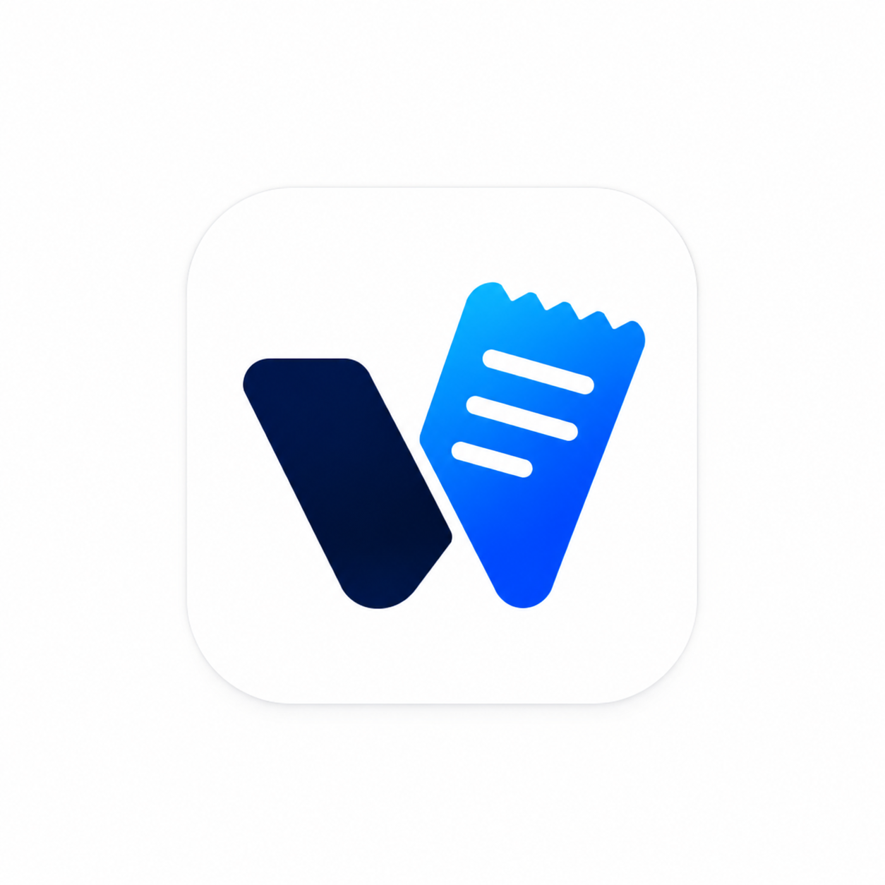
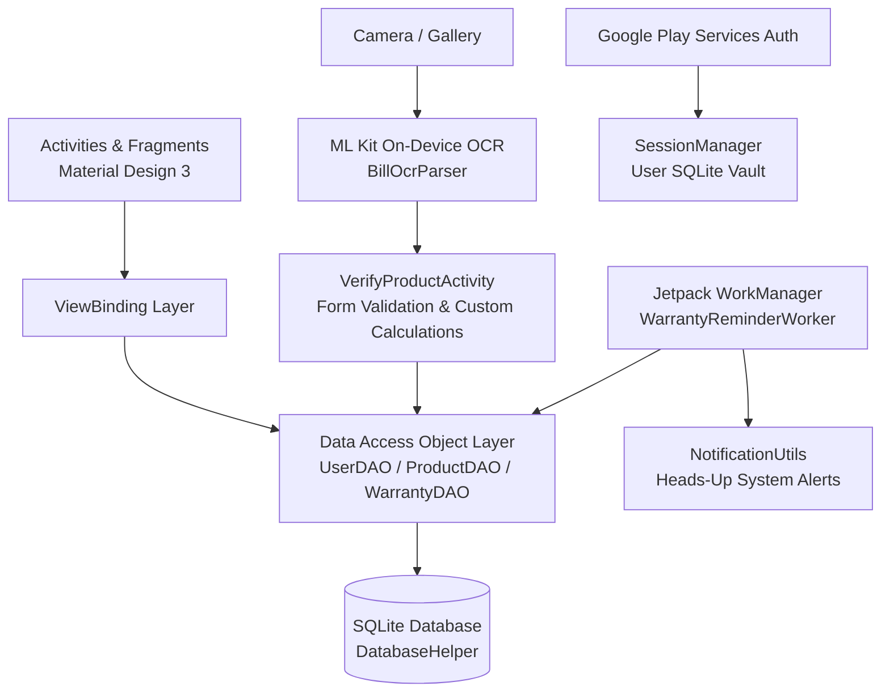

# 🛡️ Warrant Vault

<p align="center">
  
</p>

<p align="center">
  <strong>Digital Warranty & Purchase Invoice Manager</strong><br>
  <em>Your Purchases. Protected. Completely Offline & Private.</em>
</p>

<p align="center">
  
  
  
  
  
  
</p>

---

## 📖 Overview

**Warrant Vault** is a native, offline-first Android application designed to eliminate paper clutter and safeguard consumer purchase rights. It digitizes physical receipts, invoices, and warranty cards through on-device machine learning OCR, automatically tracks expiration dates, logs repair histories, and proactively fires alerts before warranties lapse.

Built with an **offline-first philosophy**, all images, documents, and personal purchase data remain strictly on your physical device in an encrypted/isolated SQLite environment—no third-party cloud servers, no subscriptions, and zero data tracking.

---

## ✨ Key Features

### 📸 On-Device ML Kit OCR Scanner
- **Instant Bill Extraction**: Capture receipts using the device camera or pick from the gallery.
- **Privacy-Preserving**: Powered by Google ML Kit's bundled Latin optical text recognition model running 100% locally on-device.
- **Smart Regex Parser**: Automatically identifies and extracts:
  - Product Name & Model Number
  - Brand & Category
  - Purchase Date & Invoice / Bill Number
  - Purchase Price & Merchant/Seller Name

### 🛡️ Smart Warranty Tracking & Coverage Engine
- **Preset Durations**: 6 Months, 12 Months, 18 Months, 2 Years, 3 Years, 5 Years.
- **Custom Duration Input**: Enter any arbitrary duration in **Months** or **Years** with instant date recalculation.
- **"No Warranty" Mode**: Clean support for lifetime products or items without warranty coverage.
- **Visual Progress & Countdown**: Live countdown timer, percentage-elapsed progress indicators, and color-coded status badges:
  - 🟢 `WARRANTY ACTIVE`
  - 🟠 `EXPIRING SOON` (≤ 30 days)
  - 🔴 `EXPIRED`
  - ⚪ `NO WARRANTY`

### 📁 Centralized Document Vault
- Keep purchase invoices, extended warranty slips, user manuals, and insurance paperwork bound to each product.
- Built-in full-screen pinch-to-zoom document viewer.

### 🔧 Service & Repair Log
- Track repair histories, authorized service center visits, and replacement records.
- Status management: *Submitted*, *Under Inspection*, *Repairing*, *Completed*, *Replaced*, or *Custom status text*.
- Interactive timeline with editing and deletion support.

### 🔔 Smart Background Alarms & Push Notifications
- Powered by **Android Jetpack WorkManager** running 24-hour periodic audits.
- Multi-tier alert thresholds: **30 days**, **14 days**, **7 days**, and **1 day** before warranty expiration.
- Instant push alerts upon product registration.
- Full compliance with **Android 13+ (API 33+)** runtime `POST_NOTIFICATIONS` permissions and high-priority channels with heads-up alerts.

### 🔐 Multi-User Vault & Google Sign-In
- **Local Authentication**: Secure password-protected login with SHA-256 salted hashes.
- **Continue with Google**: Seamless one-tap Google Sign-In using Google Play Services Auth—zero Firebase dependencies, automatic local account provisioning, and strict data isolation per `user_id`.

### 💾 Backup, Restore & Data Portability
- Single-tap database backup and restoration for disaster recovery or device migration.

---

## 🏛️ Architecture & System Design



---

## 🛠️ Tech Stack & Libraries

| Component | Technology / Library | Purpose |
| :--- | :--- | :--- |
| **Language** | Java 17 | Core application programming |
| **Minimum SDK** | API 24 (Android 7.0 Nougat) | Wide device compatibility (~95%+ market share) |
| **Target SDK** | API 35 (Android 15) | Modern Android standards and privacy controls |
| **UI Framework** | Material Components 3 (`com.google.android.material:material:1.12.0`) | Modern styling, bottom sheets, cards, text inputs |
| **View Binding** | Android Jetpack ViewBinding | Type-safe and null-safe view access |
| **On-Device OCR** | Google ML Kit (`com.google.mlkit:text-recognition:16.0.1`) | Offline text recognition from receipts and bills |
| **Background Jobs**| Jetpack WorkManager (`androidx.work:work-runtime:2.9.1`) | Reliable periodic warranty expiration checks |
| **Authentication** | Google Play Services Auth (`play-services-auth:21.3.0`) | One-tap Google Sign-In with zero Firebase footprint |
| **Local Storage** | Native Android SQLite (`SQLiteOpenHelper`) | Relational, offline-first structured database |
| **Navigation** | AndroidX Fragment & BottomNavigationView | Fluid tab switching and modular screen architecture |

---

## 📂 Project Directory Structure

```
Warrant-Vault/
├── app/
│   ├── src/
│   │   ├── main/
│   │   │   ├── java/com/warrantvault/
│   │   │   │   ├── activities/          # Activity controllers
│   │   │   │   │   ├── AuthActivity.java              # Login, Sign Up, Google Auth
│   │   │   │   │   ├── MainActivity.java              # Root container & navigation
│   │   │   │   │   ├── ProductDetailsActivity.java    # Full product details & services
│   │   │   │   │   ├── VerifyProductActivity.java     # Add/Edit product & warranty form
│   │   │   │   │   ├── ScanBillActivity.java          # OCR Camera/Gallery scanner
│   │   │   │   │   ├── DocumentViewerActivity.java    # Full-screen invoice viewer
│   │   │   │   │   ├── SplashActivity.java            # App entry & splash screen
│   │   │   │   │   └── OnboardingActivity.java        # Welcome introduction slides
│   │   │   │   ├── adapters/            # RecyclerView adapters
│   │   │   │   │   ├── ProductAdapter.java            # Product cards list adapter
│   │   │   │   │   ├── ExpiringSoonAdapter.java       # Expiring carousel cards
│   │   │   │   │   ├── ServiceRecordAdapter.java      # Service timeline adapter
│   │   │   │   │   ├── DocumentAdapter.java           # Document attachment items
│   │   │   │   │   └── NotificationAdapter.java       # In-app alerts list adapter
│   │   │   │   ├── dao/                 # Data Access Objects (SQLite CRUD)
│   │   │   │   │   ├── ProductDAO.java
│   │   │   │   │   ├── WarrantyDAO.java
│   │   │   │   │   ├── DocumentDAO.java
│   │   │   │   │   ├── ServiceRecordDAO.java
│   │   │   │   │   ├── UserDAO.java
│   │   │   │   │   └── NotificationDAO.java
│   │   │   │   ├── database/            # Database schema & migrations
│   │   │   │   │   └── DatabaseHelper.java
│   │   │   │   ├── fragments/           # Navigation fragments
│   │   │   │   │   ├── HomeFragment.java              # Dashboard, counts & highlights
│   │   │   │   │   ├── VaultFragment.java             # Searchable/filterable inventory
│   │   │   │   │   ├── AlertsFragment.java            # Notifications history
│   │   │   │   │   ├── ProfileFragment.java           # Settings, backup, toggles
│   │   │   │   │   └── AddProductBottomSheet.java     # Quick action picker
│   │   │   │   ├── models/              # POJO domain entities
│   │   │   │   ├── utils/               # Helpers & calculation engines
│   │   │   │   │   ├── BillOcrParser.java             # Regex extraction from OCR text
│   │   │   │   │   ├── DateUtils.java                 # Date normalization & math
│   │   │   │   │   ├── WarrantyUtils.java             # Metric & status calculations
│   │   │   │   │   ├── NotificationUtils.java         # System channels & notifications
│   │   │   │   │   └── SessionManager.java            # SharedPreferences session store
│   │   │   │   ├── workers/             # Background WorkManager tasks
│   │   │   │   │   └── WarrantyReminderWorker.java
│   │   │   │   └── WarrantVaultApp.java # Application class (Channels & NightMode setup)
│   │   │   └── res/                     # XML Layouts, drawables, colors, styles
│   │   └── test/                        # Local unit tests
│   └── build.gradle                     # Module-level Gradle configuration
├── gradle/wrapper/                      # Gradle wrapper binaries
├── build.gradle                         # Root-level Gradle configuration
├── settings.gradle                      # Project repository settings
└── README.md                            # Project documentation
```

---

## 🚀 Getting Started & Setup

### Prerequisites
1. **Android Studio**: Ladybug (2024.2.1) or later recommended.
2. **Java Development Kit (JDK)**: Version 17.
3. **Android SDK**: API 35 SDK platform installed.
4. **Physical Device or Emulator**: Android 7.0+ with Google Play Services enabled.

### Installation Steps

1. **Clone the repository**:
   ```bash
   git clone https://github.com/ashishkumar817/Warrant-Vault-main.git
   cd Warrant-Vault-main
   ```

2. **Open in Android Studio**:
   - Launch Android Studio.
   - Select **Open** and select the cloned `Warrant-Vault-main` directory.
   - Wait for Gradle to download dependencies and sync.

3. **Build the APK**:
   ```bash
   # On Windows (PowerShell)
   .\gradlew.bat assembleDebug

   # On macOS / Linux
   ./gradlew assembleDebug
   ```

4. **Deploy to Device**:
   - Connect your Android phone via USB with **USB Debugging** enabled.
   - Click **Run 'app'** (`Shift + F10`) in Android Studio.

---

## 🔒 Security & Privacy by Design

- **Zero Remote Telemetry**: Warrant Vault makes no network calls to upload your personal data or invoices.
- **Local Credential Security**: Passwords are saved using standard SHA-256 cryptographic hashing with randomized per-user salts.
- **Scoped Internal Storage**: Scanned bills and attachments are saved inside private app-specific storage (`Context.getFilesDir()`), preventing unauthorized access by other applications on the device.

---

## 🤝 Contributing

Contributions, feature requests, and issue reports are welcome!
1. Fork the Project.
2. Create your Feature Branch (`git checkout -b feature/AmazingFeature`).
3. Commit your Changes (`git commit -m "feat: add AmazingFeature"`).
4. Push to the Branch (`git push origin feature/AmazingFeature`).
5. Open a Pull Request.

---

## 📄 License

This project is licensed under the MIT License — see the LICENSE file for details.

<p align="center">
  Developed with ❤️ by <strong>Ashish Kumar</strong>
</p>
